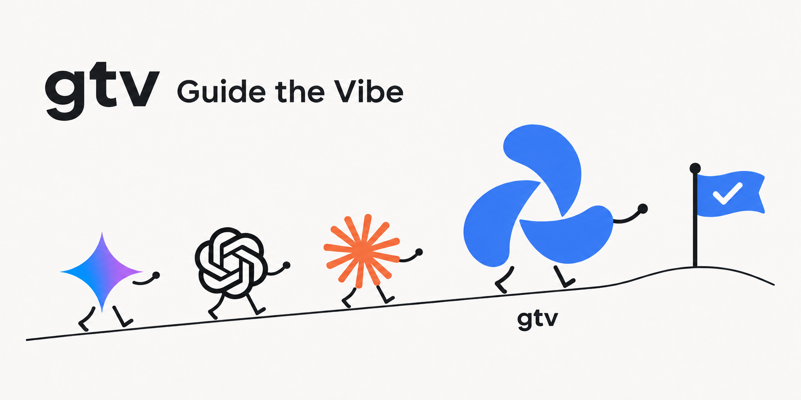
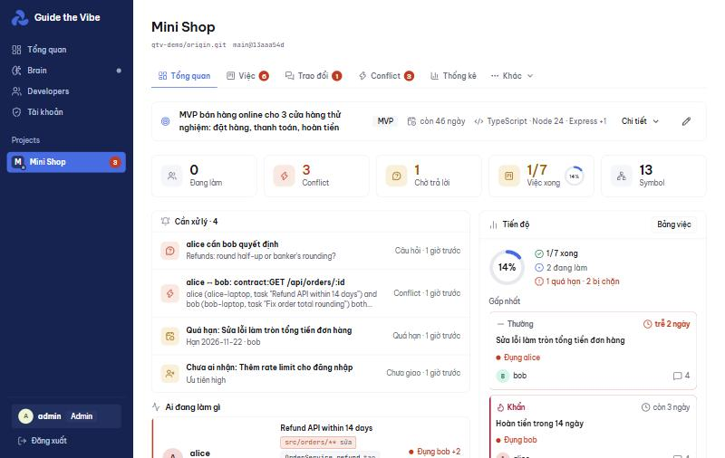

<p align="center">
  
</p>

<h1 align="center">gtv · Guide the Vibe</h1>

<p align="center">
  <b>Keeps several AI coding agents on one repository from stepping on each other.</b><br>
  For small teams where every developer codes with Claude Code or Codex.
</p>

<p align="center">
  <a href="https://github.com/hienduc14/guide-the-vibe/actions/workflows/ci.yml"></a>
  <a href="https://www.npmjs.com/package/guide-the-vibe"></a>
</p>

---

## The problem

Three developers, three AI agents, one repository. The agents can't see each other:

- one agent renames a function another agent is still calling;
- two agents rewrite the same file at the same time;
- nobody notices until the merge, and people interrupt each other with questions an agent could have answered.

## What gtv does

gtv adds a **Project Operator**: one server the whole team's agents talk to.

|                                   |                                                                                                                                                                                            |
| --------------------------------- | ------------------------------------------------------------------------------------------------------------------------------------------------------------------------------------------ |
| 📝 **Register before editing**    | Before touching code, each agent says what it will change (goal, files, functions, APIs). The Operator answers with overlapping work and relevant team decisions.                          |
| ⚡ **Catch conflicts early**      | Same file, same function, a broken caller, or two plans that contradict each other: caught while people are still coding, not at merge time.                                               |
| 💬 **Answer questions**           | "Who calls this?", "What is Bob changing?", "Why did we decide this?" The Operator answers from the code and the team's documents, or forwards the question to the right teammate's agent. |
| 📊 **Show the lead what matters** | A dashboard with who is working on what, where people collide, which questions wait for a person, and how far the project is.                                                              |

Nobody's agent is ever stopped: gtv warns and advises, people decide.

## The dashboard

<p align="center">
  
</p>

One page per project, built for the team lead:

- **Tổng quan** (overview): the project goal, five numbers (working now, conflicts, questions waiting, tasks done,
  code size), what needs a person, and one row per agent session showing the files it touches and who it clashes with.
- **Việc** (tasks): a kanban board. Developers pick tasks from inside their agent with `/gtv`; status follows the
  real work (in progress → blocked by a conflict → waiting for merge → done).
- **Trao đổi** (conversations): agent questions, conflict notices and hand-offs as chat threads. The lead can reply
  straight into a developer's agent.
- **Conflict**: every collision, its evidence and its severity.
- **Thống kê** (statistics): tasks left over time, tasks done per day, progress per person, upcoming deadlines.
- **Khác** (more): members, project documents, Q&A log, code map, detection layers and settings.

The dashboard is in Vietnamese. Try it with sample data and no AI model: `npm run demo`, then open
http://localhost:7395.

## Getting started

**You need:** Docker on a machine your team can reach. Each developer needs Node.js 20+ and git.

**1. Start the server** (the admin, once)

```bash
git clone https://github.com/hienduc14/guide-the-vibe && cd guide-the-vibe
cp docker/.env.example docker/.env
# In docker/.env set two secrets, each from: openssl rand -hex 32
#   GTV_ADMIN_TOKEN   rescue key for scripts (the dashboard itself uses accounts)
#   GTV_SECRET_KEY    encrypts the model credentials you add later
docker compose -f docker/compose.yml --env-file docker/.env up -d --build
```

Put port 7390 behind HTTPS and open it: the first page creates the admin account (it asks for `GTV_ADMIN_TOKEN`, so
a stranger cannot take the server first). Under **Quản trị server › Đăng ký** choose who may sign up: anyone (the
default), only people with an invite link, or nobody.

**2. Connect an AI model** (optional, but needed for answers and the smartest conflict check)

On **AI trả lời**, either sign in with a subscription you already have (Claude Pro/Max, ChatGPT, GitHub Copilot…),
paste an API key (Anthropic, OpenAI, Google, OpenRouter and ~30 more), or point to any OpenAI- or
Anthropic-compatible endpoint. A small, fast model is enough.

**3. Everyone signs up, then creates a project or opens an invite**

Each person signs up on the server with a user name and a password (`/signup`). Whoever starts a project chooses
**Tạo project**, pastes the repository URL and checks it (for a private repository use a URL with a read token, e.g.
`https://x-access-token:<token>@github.com/org/repo.git`), and becomes its manager. On **Thiết lập › Thành viên** they
make an invite link (developer or viewer, 1–30 days) and send it to the team, or add people who already have an account
by their user name. Opening the link and pressing **Tham gia** joins the project.

**4. Each developer, once per computer and once per repo**

The three commands are also under **Máy của tôi › Kết nối máy mới**:

```bash
npx guide-the-vibe   # installs the gtv command
gtv login            # asks for your server; approve this computer in the browser
gtv on               # inside the project's repo: hooks, MCP server and skill for Claude Code / Codex
```

That's it: they keep prompting their agent as usual. Day to day: `gtv status`, `gtv open`, `gtv answer`; when
something is off, `gtv doctor`. The CLI guide (in Vietnamese): [docs/cli.md](docs/cli.md).

## How it works

```
 Each developer's machine                          Team server (Docker)
 ┌────────────────────────────────┐   HTTPS   ┌───────────────────────────────────────────┐
 │ Claude Code / Codex            │   + SSE   │ Operator                                  │
 │   hooks · gtv_* tools · skill  │◄─────────►│   task registry, conflict layers L0–L3,   │
 │              │                 │           │   Q&A, documents, code graph, dashboard   │
 │              ▼                 │           │   Brain: an LLM with read-only tools      │
 │ gtv daemon (127.0.0.1:7391)    │           └──────────────┬─────────────────────┬──────┘
 │   WIP snapshots ──git push──┐  │                git fetch │                     │ HTTPS
 └─────────────────────────────┼──┘                          │             ┌───────▼────────┐
                               ▼                             │             │ Any LLM        │
                        ┌─────────────┐                      │             │ provider       │
                        │ Git remote  │◄─────────────────────┘             └────────────────┘
                        └─────────────┘
```

- **Operator**: one server for the whole team, several projects (one per repository), SQLite + git mirrors.
- **Daemon**: runs on each developer's machine, answers most agent hooks locally and pushes work-in-progress
  snapshots to a private git ref.
- **Agent integration**: hooks report what the agent is doing; an MCP server gives it `gtv_*` tools (register a
  task, ask a question, pick a task…); a skill tells it when to use them.
- **Brain**: an optional [Pi](https://github.com/earendil-works/pi) agent loop inside the Operator, with any model
  provider. Without it, registration, conflict layers L0–L2 and question forwarding still work.

<details>
<summary><b>The four conflict layers</b></summary>

Each layer can be `on`, `off` or `shadow` (runs and logs, tells nobody), per project.

| Layer | Catches                                                                       | How                                                               |
| ----- | ----------------------------------------------------------------------------- | ----------------------------------------------------------------- |
| L0    | Same file, overlapping scope, the same symbol or API contract, critical paths | Compares registered tasks and edit footprints                     |
| L1    | Text conflicts before anyone opens a pull request                             | `git merge-tree` on work-in-progress snapshots                    |
| L2    | "Alice changed `getUser`'s signature, and Bob's new code calls it"            | Symbol diff with tree-sitter over a code graph of every workspace |
| L3    | Two tasks whose intentions conflict, even in different files                  | The Brain judges the registrations against each other             |

</details>

<details>
<summary><b>Try it on one machine</b></summary>

The sandbox creates a sample repository with two clones, `alice` (Claude Code) and `bob` (Codex), each with its own
daemon, so you can watch conflicts appear on the dashboard. Requires Node.js 24, git 2.40+ and Docker.

```bash
npm ci && npm run web:install
node scripts/sandbox.ts
```

Wiring an agent by hand: [docs/agents.md](docs/agents.md).

</details>

<details>
<summary><b>Configuration</b></summary>

| Variable                        | Purpose                                                                       |
| ------------------------------- | ----------------------------------------------------------------------------- |
| `GTV_ADMIN_TOKEN`               | Rescue key for the admin API and scripts (required by the Docker setup)       |
| `GTV_SECRET_KEY`                | Encrypts model credentials in the database (required by the Docker setup)     |
| `GTV_PORT`, `GTV_HOST`          | Listen address, default `0.0.0.0:7390`                                        |
| `GTV_DATA`                      | Data directory: hub database, one database per project, git mirrors           |
| `GTV_POLL_MS`                   | How often to fetch each repository: 30 s by default, 15 s in the Docker setup |
| `BRAIN_BACKEND`                 | `pi` turns the Brain on (the Docker setup does); unset or `null` keeps it off |
| `BRAIN_MODEL`, `BRAIN_THINKING` | Optional defaults; normally chosen on the dashboard                           |

Full list, deployment notes and troubleshooting: [docs/operations.md](docs/operations.md).

</details>

<details>
<summary><b>Security</b></summary>

- **Accounts**: one per person, made by signing up (open, invite-only or closed, chosen by the admin). The dashboard
  session is an httpOnly cookie, and writes must come from the dashboard's own pages. Forgotten passwords: the admin
  makes a one-time reset link (1 hour). Each project gives its members manager, developer or viewer access; agents only
  work where their person is a developer or manager. Projects are private: outsiders cannot even see their names. A
  read-only link can show one project to outsiders.
- **Repositories**: anyone may create a project, so the server only clones `https://` and `git@host:` addresses, never
  local paths, other transports or hosts on its own network, and reads the repo before creating the project.
- **Computers**: `gtv login` approves a computer in the browser; each gets its own key, stored only as a hash on the
  server and revocable from the dashboard. Login, sign-up, invite, reset and connection codes are rate limited.
- **Model credentials**: encrypted with `GTV_SECRET_KEY`; the API only ever returns the last four characters.
- **Daemon**: listens on `127.0.0.1` only and refuses requests from browsers.
- **Brain**: read-only tools; it can read code, documents and team state but never change the repository.

</details>

## Documentation

Detailed docs are in Vietnamese.

| Read this                                                       | To learn                                                            |
| --------------------------------------------------------------- | ------------------------------------------------------------------- |
| [Features](docs/features.md)                                    | Every feature and detection layer: behaviour, modes, limits         |
| [Architecture](docs/architecture.md)                            | Components, data flow, storage, security                            |
| [CLI](docs/cli.md)                                              | `gtv login`, `gtv on`, daily commands, troubleshooting              |
| [Agents](docs/agents.md)                                        | Claude Code and Codex setup, files written by `gtv on`              |
| [Hooks](docs/hooks.md)                                          | What every hook does, step by step                                  |
| [API](docs/api.md)                                              | Server, daemon and MCP tool reference                               |
| [Operations](docs/operations.md)                                | Deployment, environment variables, accounts, Brain, troubleshooting |
| [Dashboard](web/README.md) · [Design](DESIGN.md)                | Dashboard code layout and its design system                         |
| [Project structure](docs/project-structure.md)                  | Source layout and module ownership                                  |
| [Development](docs/development.md) · [Testing](docs/testing.md) | Conventions, adding features, test suite                            |
| [Specification](SPEC.md)                                        | Design rationale and evaluation                                     |

## Development

```bash
npm run check        # typecheck, formatting and the full test suite; run before pushing
npm run demo         # local server with sample data, no LLM: http://localhost:7395
npm run web:dev      # dashboard with hot reload
npm run web:build    # build the dashboard into web/dist
```

The server is TypeScript run directly by Node.js 24 (no build step); the dashboard is React + Vite. CI runs on
Ubuntu and Windows.

## Status

A university course project ("AI agents coordinating a coding project"), still a prototype. The core flows run end
to end with real Claude Code and Codex sessions; in the
[self-test on a real Express codebase](docs/reports/selftest-realworld.md) two developers edit in parallel and all 21
checks pass.

Not built yet: GitHub pull request comments and a pre-push gate, semantic search over documents, more agents (such
as Cursor). See [SPEC.md](SPEC.md) for the roadmap.
