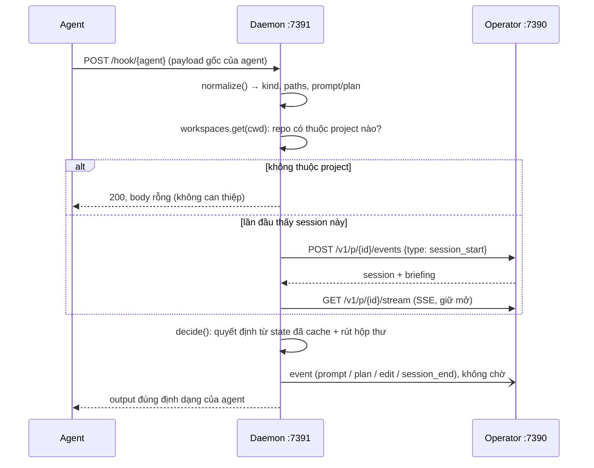
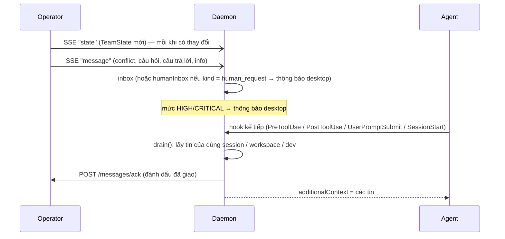
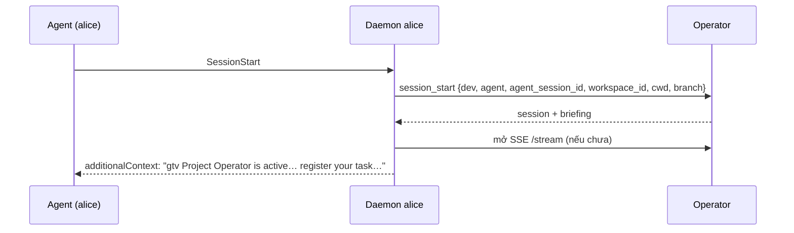
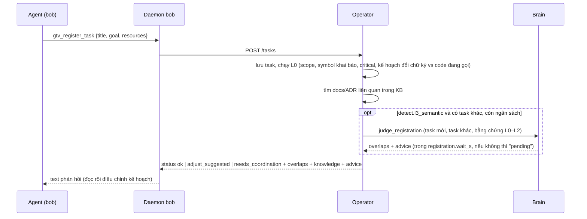
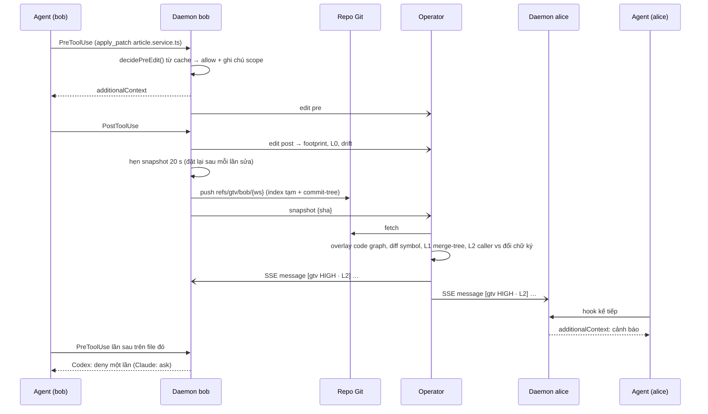
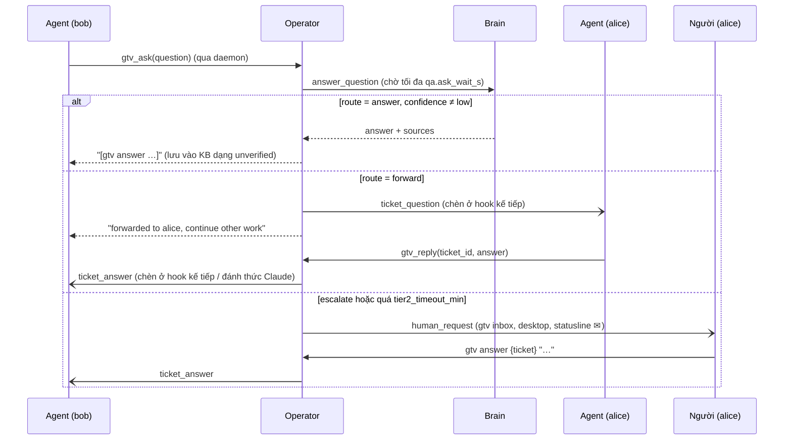
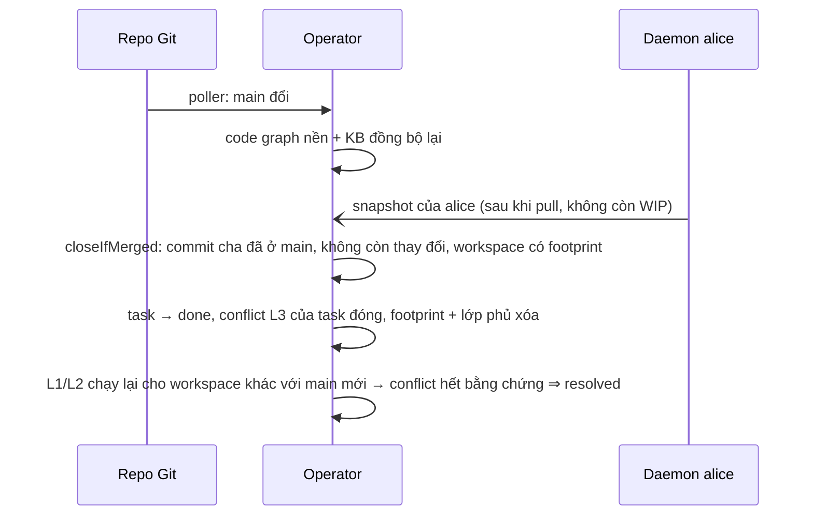

# Hook và luồng chi tiết

Tài liệu mức thấp: mỗi hook của agent đi đâu, daemon làm gì, server làm gì, agent nhận lại gì; và các luồng chính theo
từng bước. Mức tổng quan: [architecture.md](architecture.md). File cài hook cho từng agent: [agents.md](agents.md).

## 1. Đường đi chung của một hook



Ba cách agent gọi daemon:

| Agent       | Kiểu hook                   | Gọi daemon thế nào                                                                                                                    |
| ----------- | --------------------------- | ------------------------------------------------------------------------------------------------------------------------------------- |
| Claude Code | `type: "http"`              | Claude POST thẳng payload tới `http://127.0.0.1:<port>/hook/claude`                                                                   |
| Codex       | `type: "command"`           | Codex chạy `node bin/gtv.mjs hook codex --daemon <url>`; shim JS thuần đọc stdin, POST tới daemon (timeout 8 s), in kết quả ra stdout |
| omp         | extension TS (`pi.on(...)`) | Extension POST `/hook/omp` với payload tự dựng; kết quả là `HookDecision` thô (`decision`, `reason`, `context`)                       |

**Fail-open ở mọi bước:** repo không thuộc project ⇒ body rỗng; không tạo được session (server sập) ⇒ body rỗng;
lỗi bất kỳ trong `handleHook` ⇒ log và trả 200 rỗng; shim Codex lỗi/timeout ⇒ không in gì, exit 0; extension omp
không tới được daemon ⇒ không chặn. Body rỗng nghĩa là agent làm tiếp như không có gtv.

**Quyết định không chờ server:** `decide()` chỉ đọc `TeamState` (task, footprint, conflict, feature) mà daemon nhận qua
SSE và giữ trong bộ nhớ, nên hook trả lời trong vài chục ms. Event gửi lên server đi qua một hàng đợi nối tiếp
(`send()`), không chặn câu trả lời cho agent.

## 2. Bảng tra cứu từng hook

| Kind (sau normalize) | Claude Code                                                                      | Codex                                                                                                   | omp                           |
| -------------------- | -------------------------------------------------------------------------------- | ------------------------------------------------------------------------------------------------------- | ----------------------------- |
| `session_start`      | `SessionStart`                                                                   | `SessionStart`                                                                                          | `session_start`               |
| `prompt`             | `UserPromptSubmit`                                                               | `UserPromptSubmit`                                                                                      | `input`                       |
| `pre_edit`           | `PreToolUse`, tool `Edit` / `Write` / `MultiEdit` / `NotebookEdit` (`file_path`) | `PreToolUse`, tool `apply_patch` (đọc `*** Add/Update/Delete File:`, `*** Move to:`) / `Edit` / `Write` | `tool_call` có đường dẫn file |
| `plan`               | `PreToolUse`, tool `ExitPlanMode` (`tool_input.plan`)                            | `PreToolUse`, tool `update_plan` (`explanation` + các bước)                                             | —                             |
| `post_tool`          | `PostToolUse` (mọi tool; có `paths` nếu là tool sửa file)                        | `PostToolUse`                                                                                           | `tool_result`                 |
| `stop`               | `Stop` (+ hook command `gtv hook-wait claude`, `asyncRewake: true`)              | `Stop`                                                                                                  | —                             |
| `session_end`        | `SessionEnd`                                                                     | `SessionEnd`                                                                                            | `session_shutdown`            |

Daemon xử lý từng kind (`src/daemon/daemon.ts`, `decide()`):

| Kind            | Daemon làm tại chỗ                                                                                                         | Event gửi server                     | Agent nhận lại                                                                                                                                   |
| --------------- | -------------------------------------------------------------------------------------------------------------------------- | ------------------------------------ | ------------------------------------------------------------------------------------------------------------------------------------------------ |
| `session_start` | Tạo session (nếu mới) → lấy **briefing**; rút hộp thư                                                                      | `session_start` (khi session mới)    | `additionalContext` = briefing + tin chờ                                                                                                         |
| `prompt`        | Rút hộp thư                                                                                                                | `prompt` (cắt 500 ký tự, chỉ để log) | `additionalContext` = tin chờ (nếu có)                                                                                                           |
| `plan`          | Rút hộp thư                                                                                                                | `plan` (toàn văn)                    | `additionalContext` = tin chờ; luôn **allow**                                                                                                    |
| `pre_edit`      | Đổi `paths` thành đường dẫn trong repo (bỏ file ngoài repo); `decidePreEdit()` → allow / ask / deny + ghi chú; rút hộp thư | `edit` `phase: "pre"`                | Claude/Codex: `permissionDecision` (chỉ khi ask/deny) + `permissionDecisionReason` + `additionalContext`; omp: `{block, reason}` nếu không allow |
| `post_tool`     | Nếu có file bị sửa: hẹn **snapshot** sau `GTV_SNAPSHOT_DEBOUNCE_MS` (20 s, mỗi lần sửa đặt lại hẹn); rút hộp thư           | `edit` `phase: "post"` (khi có file) | `additionalContext` = tin chờ (omp: nối vào kết quả tool)                                                                                        |
| `stop`          | Hẹn snapshot sau 2 s                                                                                                       | —                                    | không gì (Claude: waiter `hook-wait` bắt đầu chờ tin)                                                                                            |
| `session_end`   | Hẹn snapshot sau 1 s                                                                                                       | `session_end`                        | không gì                                                                                                                                         |

### `decidePreEdit()` — quyết định trước khi sửa

Đầu vào: các file sắp sửa, conflict đang mở của workspace, footprint và task của người khác (`src/daemon/decide.ts`).

1. Conflict đang mở chạm vào file (theo `subject`, `evidence.path`, danh sách file hai bên, hoặc vị trí caller của L2), xếp mức cao trước:
   - `critical`, hoặc `high` **lần đầu** trong session, khi `policy.ask` bật ⇒ Claude: **ask**; agent không có ask (Codex, omp): **deny**.
     Lý do kèm theo: high ⇒ "Stopped once so you can coordinate… If you still want this edit, retry it." (thử lại thì high đã "seen" nên cho qua);
     critical ⇒ "blocked until the conflict is acknowledged" (chặn tới khi `gtv_ack`).
   - mức khác, lần đầu ⇒ thêm ghi chú `[gtv <level>] <message> (<id>)`. `info` không ghi chú.
2. Người khác đang sửa cùng file mà server chưa báo conflict ⇒ ghi chú "X is also editing …" (mỗi file một lần).
3. File nằm trong scope đã đăng ký của người khác ⇒ ghi chú ngay, không chờ server.
4. Session chưa đăng ký task ⇒ nhắc `gtv_register_task` một lần.

Khả năng từng agent (`AGENT_CAPABILITIES`): Claude `ask + inject + rewake`; Codex `inject`; omp `inject + rewake`.

## 3. Kênh ngược: server → agent

Agent không nghe server; tin được **chèn vào lần hook kế tiếp**.



- **Ai nhận:** tin có `to_session` ⇒ đúng session; `to_workspace` ⇒ mọi session trong workspace đó; còn lại theo `to_dev`.
- **Claude đang rảnh** (đã trả lời xong, chờ người): hook `Stop` chạy `gtv hook-wait claude` với `asyncRewake: true` → long-poll
  `GET /wait` (tối đa 30 phút, mỗi Stop mới thay waiter cũ). Có tin ⇒ waiter in tin ra stderr và **exit 2** ⇒ Claude được
  đánh thức với nội dung đó.
- **omp:** tin được chèn bằng `pi.sendMessage(…, { deliverAs: "steer" })`, hoặc nối vào kết quả tool ở `tool_result`.
- **Codex:** không có cơ chế đánh thức; tin đến ở lần gọi tool kế tiếp.
- **Tin cho người** (`human_request`): không chèn vào agent; hiện ở `gtv inbox`, statusline (✉), thông báo desktop.

Các loại tin: `conflict` (mọi conflict mức ≥ warning, gửi cho **cả hai** workspace), `info` (drift, đăng ký từ plan, L3 đến
muộn), `ticket_question` (bậc 2), `ticket_answer` (câu trả lời đến sau), `human_request` (bậc 3).

## 4. Tool `gtv_*` của agent đi đâu

```
Agent ──MCP stdio──► gtv mcp (--agent auto|claude|codex) ──POST /api/<tool> {agent, cwd, args}──► Daemon
Daemon: sessionForTool() = session hook gần nhất của agent đó trong workspace (chưa có thì tạo "mcp-<agent>-<ws>")
       → runTool() → API server (/tasks, /tickets, /conflicts/:id/ack, …) → text trả về agent
omp: extension tự đăng ký 9 tool, gọi cùng /api/<tool> (không qua MCP)
```

`gtv_inbox` rút hộp thư (tin chờ + câu hỏi đang chờ mình); `gtv_finish_task` hẹn snapshot sau 0,5 s để server sớm thấy trạng thái cuối.

## 5. Server xử lý từng event

| Event           | `Engine.handle()` (`src/server/project/engine.ts`)                                                                                                                                                                                  |
| --------------- | ----------------------------------------------------------------------------------------------------------------------------------------------------------------------------------------------------------------------------------- |
| `session_start` | Upsert session + workspace (dev được lấy từ token, không tin payload); trả **briefing**: task đang chạy của người khác, conflict của mình, câu hỏi đang chờ mình, nhắc đăng ký                                                      |
| `prompt`        | Cập nhật thời điểm hoạt động; ghi `event_log`                                                                                                                                                                                       |
| `plan`          | Session chưa có task và `registration.auto_from_plan` ≠ off ⇒ job Brain `extract_intent_from_plan`; `on` ⇒ đăng ký thật và gửi tin `info`; `shadow` ⇒ chỉ ghi `plan_intent`                                                         |
| `edit`          | Thêm footprint; có file mới ⇒ chạy lại **L0**; file ngoài scope đã đăng ký ⇒ ghi `drift` và (mode `on`) gửi tin nhắc `gtv_update_task` (mỗi file một lần)                                                                           |
| `snapshot`      | Chạy nền (lỗi chỉ log): `git fetch` → ghi snapshot + merge-base → đồng bộ code graph (lớp nền main + lớp phủ workspace) → diff symbol + dòng đã sửa (cho L2) → kiểm tra đã merge chưa → **L1 + L2** với mọi workspace khác → **L0** |
| `session_end`   | Đóng session                                                                                                                                                                                                                        |

Ngoài event, **poller** (`GTV_POLL_MS`, 15 s trong compose) mỗi vòng: `git fetch`; main đổi ⇒ đồng bộ code graph + KB,
đóng việc đã merge, chạy lại L1/L2; snapshot nào đã lên remote mà chưa có event ⇒ xử lý như event `snapshot`.
Ticket: mỗi 30 s kiểm tra hạn (bậc 2 quá `tier2_timeout_min` ⇒ bậc 3; bậc 3 quá `tier3_timeout_h` ⇒ hết hạn).

Mọi lớp đi qua `applyLayer()`: mode `shadow` ⇒ chỉ ghi `shadow_conflicts`; `on` ⇒ đồng bộ bảng conflict (conflict mới ⇒
`notifyConflicts()`, conflict hết bằng chứng ⇒ `resolved`).

## 6. Các luồng theo từng bước

### 6.1 Mở phiên



### 6.2 Đăng ký task



### 6.3 Sửa file → snapshot → phát hiện → chèn cảnh báo



### 6.4 Hỏi đáp



Brain quá `ask_wait_s` thì `gtv_ask` trả số ticket ngay, câu trả lời đến sau dưới dạng `ticket_answer`.
Brain lỗi/không tới được ⇒ ticket đóng với "Operator could not answer".

### 6.5 Merge → tự dọn



Clone chỉ `git pull` mà chưa sửa gì (không có footprint) thì **không** bị coi là đã merge.

## 7. Thời gian

| Bước                              | Thời gian                                                     |
| --------------------------------- | ------------------------------------------------------------- |
| Hook Claude (HTTP) / Codex (shim) | ~100–150 ms / ~270 ms (phần lớn là khởi động Node)            |
| Quyết định của daemon             | < 10 ms (từ cache)                                            |
| Sửa → snapshot                    | 20 s sau lần sửa cuối (`GTV_SNAPSHOT_DEBOUNCE_MS`); Stop: 2 s |
| Snapshot → L1/L2 → tin            | vài giây sau snapshot (≈ 20–25 s sau lần sửa)                 |
| Đăng ký + L3                      | L0 ngay; L3 chờ tối đa `registration.wait_s` (30 s)           |
| `gtv_ask` bậc 1                   | 10–35 s tùy model; chờ tối đa `qa.ask_wait_s` (45 s)          |
| Bậc 2 → bậc 3 → hết hạn           | 15 phút → 4 giờ                                               |
| Poller server                     | `GTV_POLL_MS` (15 s trong compose, 30 s mặc định)             |
